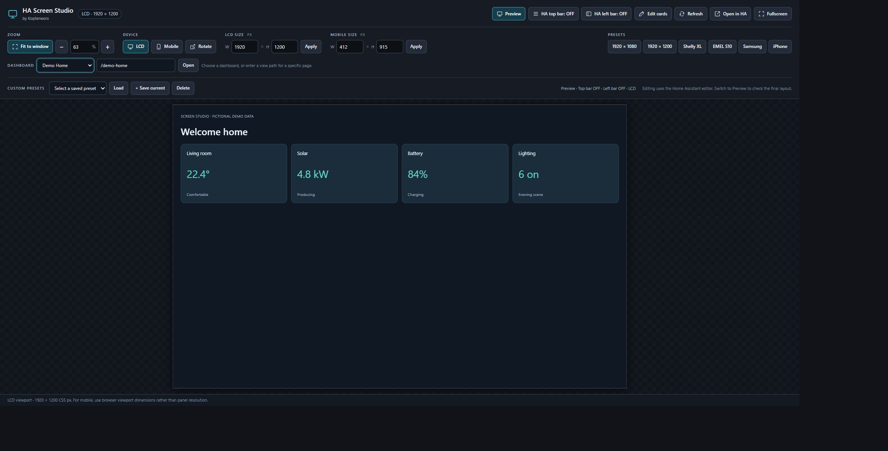
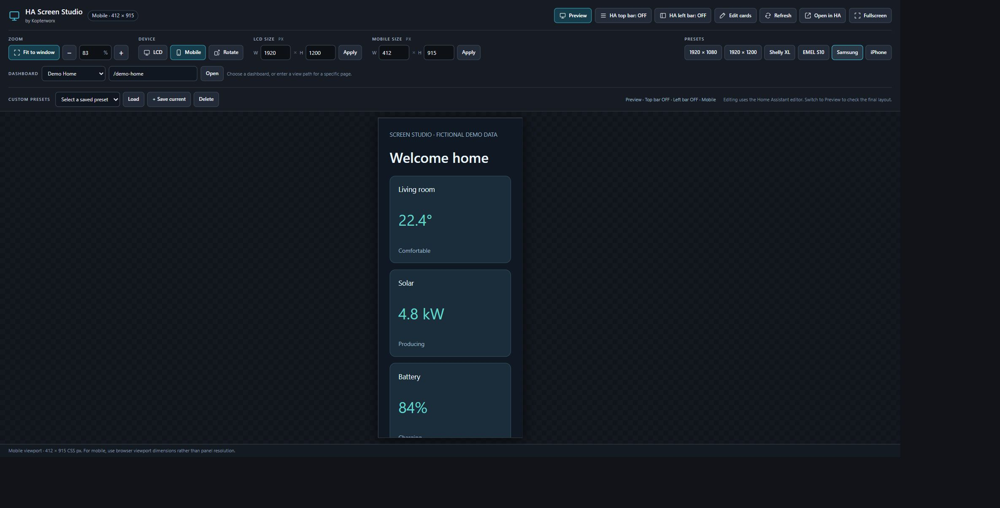
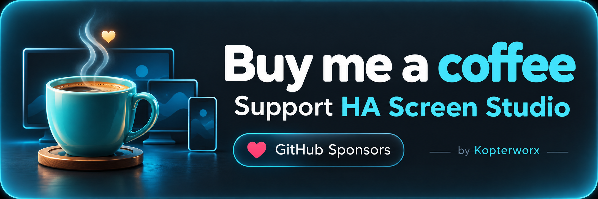

# HA Screen Studio by Kopterworx

**Design on your PC. Preview on any screen.**

Preview and edit your Home Assistant dashboards at LCD, tablet and mobile sizes, directly inside HA. Use your own dashboards and the normal Home Assistant editor.

*Screenshots show fictional demo data.*

## What you can do

- Switch between LCD and mobile sizes, rotate the screen or enter custom dimensions.
- Use ready-made presets for Full HD, EMEL S10, Shelly XL, Samsung and iPhone.
- Remember zoom separately for each preset and save your own profiles.
- Switch between a clean **Preview** and **Edit cards**, with separate top/left-bar controls.

Built for **desktop and laptop dashboard editing**. Mobile presets preview the layout; they do not emulate every phone exactly.

## Before you start

You need **Home Assistant 2026.9+**, **HACS**, an administrator account and an existing dashboard.

**Install [kiosk-mode](https://github.com/NemesisRE/kiosk-mode#installation) first.** It must be loaded as a dashboard resource for Preview to hide HA menus. Without it, screen sizing works but menu hiding does not, including through Nabu Casa. Follow its instructions to choose a version compatible with your HA, then refresh the browser.

## Installation

**Current release: v0.2.0-beta.3.** This is a testing release, available as a custom HACS repository.

1. In **HACS → menu → Custom repositories**, add `https://github.com/krleas/ha-screen-studio` as **Integration**.
2. Download **HA Screen Studio by Kopterworx**. Select the tagged **v0.2.0-beta.3** release under **Need a different version?**, rather than `main` or a short commit ID.
3. Restart Home Assistant once and refresh your browser.
4. Go to **Settings → Devices & services → Add integration**, select **HA Screen Studio** and confirm.
5. Open **Screen Studio** in the sidebar and choose your dashboard.

**For beta updates:** enable this repository's **Pre-release** switch in HACS. If it is disabled, enable it under **Settings → Devices & services → Entities** (include disabled entities), then turn it on. [Detailed instructions](https://github.com/krleas/ha-screen-studio/blob/main/docs/REFERENCE.md#beta-update-tracking--important-for-testers).

No YAML, manual Studio dashboard or access token is needed. Settings are saved in this browser. **Editing saves real changes, and dashboard controls operate real devices.**

## Need help?

- Menu controls do nothing? Check that **kiosk-mode is installed and loaded**.
- [Troubleshooting, old-beta migration and manual installation](https://github.com/krleas/ha-screen-studio/blob/main/docs/REFERENCE.md).
- [Report a problem](https://github.com/krleas/ha-screen-studio/issues) with your HA, Studio and browser versions. Remove private details from screenshots.
- [Technical details and development](https://github.com/krleas/ha-screen-studio/blob/main/docs/REFERENCE.md#development).

## Support development ❤️

Free and open source under the MIT license. [Sponsor Kopterworx](https://github.com/sponsors/krleas), star the project or share useful feedback. Support is optional; all features remain free.

Created by **Kopterworx**. Not affiliated with Home Assistant or the device manufacturers shown in presets.
