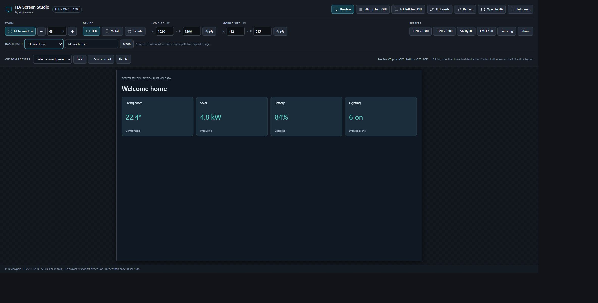
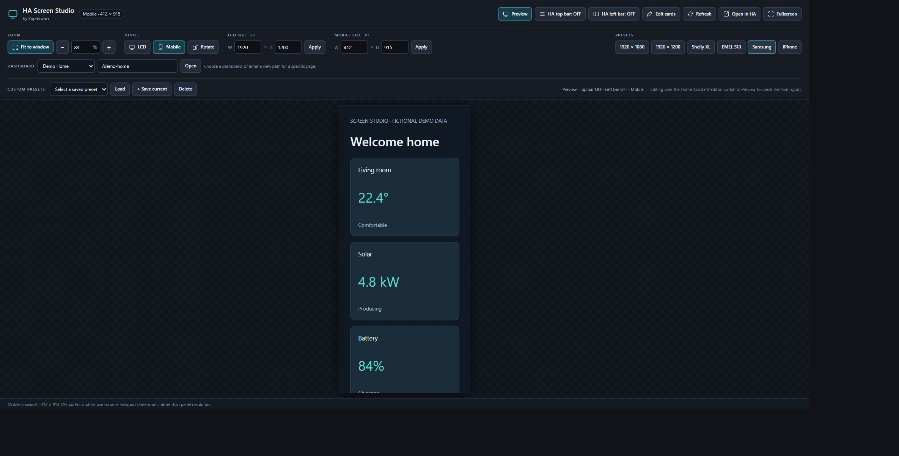

# HA Screen Studio by Kopterworx

Preview and edit your Home Assistant dashboards at fixed LCD and mobile viewport sizes, directly inside Home Assistant.





Screenshots use a fictional demonstration page; no private installation data is shown.

**Early beta: v0.2.0-beta.2.** Now packaged as a HACS **Integration** with automatic sidebar setup. The frontend has been tested on the author's installation; the new integration lifecycle has automated contract tests but still needs testing on a real HA installation. This is a custom repository, not a default HACS catalog entry.

## What it does

- Preview a dashboard in a fixed-size viewport, scaled to your computer screen.
- Switch between LCD and mobile profiles, or enter a custom size.
- Use 1920 × 1080, 1920 × 1200, Shelly XL, EMEL S10, Samsung and iPhone presets.
- Remember zoom or Fit to window separately for every preset.
- Rotate the viewport, enter fullscreen, and save named custom presets.
- Show or hide the HA top and left bars independently.
- Return to the normal Home Assistant dashboard editor with **Edit cards**.
- Choose your own dashboard. No author's dashboard paths or HA address are included.

Studio uses the normal HA editor; it does not provide a separate card editor. Changes saved while editing are real changes to the selected dashboard.

## Requirements

- A working Home Assistant installation and an existing dashboard.
- An up-to-date desktop browser. This beta is intended for desktop dashboard authoring.
- HACS for the recommended installation method.
- [kiosk-mode](https://github.com/NemesisRE/kiosk-mode) installed and registered as a dashboard resource for top/left-bar controls. Without it, viewport preview works but the bar buttons cannot hide HA menus.

## Install with HACS

Requires Home Assistant **2026.9 or newer**, HACS and an administrator account.

1. Open HACS → menu → **Custom repositories**.
2. Add `https://github.com/krleas/ha-screen-studio` with type **Integration**.
3. Download **HA Screen Studio by Kopterworx** and select the tagged **v0.2.0-beta.2** release (or a newer beta), rather than `main` or a short commit ID. Use **Need a different version?** in the download dialog if required.
4. Restart Home Assistant once, then refresh the browser.
5. Open **Settings → Devices & services → Add integration**. Search for **HA Screen Studio**, select it and confirm.
6. Open **Screen Studio** in the left sidebar and choose your own dashboard.

No YAML, manually created Studio dashboard, JavaScript resource, IP address or access token is required. The sidebar entry is visible to administrators. Dashboard selection is remembered in this browser; its selector folds away after selection. Use the **Dashboard** button at the end of the toolbar to change it. **Preview** stays first.

HACS downloads the files; the Add integration step enables the sidebar. These are separate steps. See [HACS integration documentation](https://www.hacs.dev/docs/use/repositories/type/integration/).

### Beta update tracking — important for testers

This project currently publishes **pre-releases**. In HACS, enable **Pre-release** for **HA Screen Studio by Kopterworx** so update checks track the tagged beta release. Downloading a beta manually does not necessarily enable beta tracking.

HACS also provides a **Pre-release** switch entity for this repository. If it is disabled, find it under **Settings → Devices & services → Entities**, include disabled entities in the filters, enable that specific entity, then turn its switch on. See [HACS pre-release switch documentation](https://www.hacs.dev/docs/use/entities/switch/).

If an update offers a short commit ID immediately after installing a beta, check this setting first. With beta tracking off and no regular release available, HACS can fall back to the default branch's latest commit. A README change can then look like an update. Do not install `main` just to dismiss that notice; enable beta tracking instead. Studio cannot change a user's HACS update preferences automatically.

### Upgrading from 0.1 Dashboard/Plugin beta

Version 0.1 was a dashboard card; version 0.2 is an integration. Updating the old Dashboard entry alone does not install the integration.

1. Back up your HA configuration. Keep the old working Studio dashboard until the new panel is verified.
2. In HACS, remove the old Screen Studio **Dashboard** repository entry, then add this repository again as **Integration** and follow the installation above. HACS may remove the old downloaded card file when uninstalling, so that old card can be temporarily unavailable.
3. Verify the new **Screen Studio** sidebar entry at `/ha-screen-studio` before optionally removing your old manually created Studio dashboard/resource.

The integration does not delete or rewrite existing dashboards, resources or kiosk settings. Browser preferences use the same storage keys, so they remain available on the same HA origin and browser profile.

### Manual installation

Copy the entire `custom_components/ha_screen_studio` folder from this repository to `/config/custom_components/ha_screen_studio`. Restart HA, then follow steps 5–6 above. All runtime files, including `www/ha-screen-studio.js`, must be copied together.

The legacy `dist/ha-screen-studio.js` card remains available for existing manual setups as `custom:ha-screen-studio`; it is not needed for the integration installation.

### Troubleshooting installation

- Integration missing from Add integration: confirm the folder exists under `custom_components`, restart HA after downloading, then refresh the browser.
- Studio not in the sidebar: use an administrator account and confirm the integration was added, not just downloaded.
- URL conflict: an existing panel uses `/ha-screen-studio`. Give that existing panel a different URL, then retry setup. Studio never overwrites it.
- Old layout after update: refresh the browser cache. Python integration updates require an HA restart.
- Menu hiding does not work: install and register [kiosk-mode](https://github.com/NemesisRE/kiosk-mode). It is optional for preview itself.

## Presets and pixels

| Preset | Width × height | Purpose |
| --- | --- | --- |
| Full HD | 1920 × 1080 | Landscape LCD |
| WUXGA / EMEL S10 | 1920 × 1200 | Landscape LCD; EMEL profile follows the original tested setup |
| Shelly Wall Display XL | 1280 × 752 | LCD starting point ([manufacturer specification](https://www.shelly.com/de/blogs/documentation/shelly-wall-display-xl)) |
| Samsung | 412 × 915 | Approximate mobile layout starting point |
| iPhone | 393 × 852 | Approximate mobile layout starting point |

Dimensions are **CSS pixels**, not necessarily the panel's physical pixel count. Mobile presets are approximate and are not exact emulations of every model. Browser zoom, Android display scaling, status/navigation bars and safe areas affect the actual available viewport. Validate the final layout on the real device.

Rotation keeps the current zoom and becomes a manually sized profile; it does not overwrite a built-in preset's dimensions. Save a custom preset if you want a named landscape/portrait variant.

## Privacy and behavior

Studio runs on your Home Assistant origin using your existing HA login. It does not request or store an access token. It has no analytics, telemetry, CDN dependencies or external runtime services. Settings, preset names and the selected local dashboard path are stored in this browser's local storage, shared by Studio instances on the same HA origin. They are not synced between browsers or users sharing that browser profile. Clearing site data removes these settings.

Preview is interactive: dashboard buttons can still control your real devices. Use a demo dashboard when recording public videos or screenshots.

## Known beta limitations

- This is viewport resizing, not device/user-agent or touchscreen emulation.
- kiosk-mode dashboard, per-user or cached rules can override URL flags. If a bar toggle has no effect, check those rules. Studio does not rewrite other dashboards' kiosk settings.
- **Edit cards** displays the HA menus; start editing through HA's normal dashboard menu. Save before switching modes, bars or dashboards.
- Fullscreen availability depends on browser and embedding permissions. When browser fullscreen is unavailable, Studio hides its controls and provides an **Exit fullscreen** button.
- Only same-origin dashboard paths are supported. Settings, API paths and the standard Studio host paths are rejected. Do not point Studio at another Studio wrapper under a different custom URL.
- Public distribution and broader HA/browser compatibility are still being tested.

## Report a problem

Open a [GitHub issue](https://github.com/krleas/ha-screen-studio/issues) with the Studio, HA, kiosk-mode and browser versions, reproduction steps, chosen preset and zoom. Remove private details from screenshots and console output.

## Development

Node.js 20 or later; no npm dependencies:

```sh
npm run build
npm test
npm run check
python -m unittest discover -s tests -p "test_*.py" -v
```

Edit `src/studio.html` and `src/card.js`, rebuild, and commit both generated modules (`dist/ha-screen-studio.js` and `custom_components/ha_screen_studio/www/ha-screen-studio.js`). Python tests use mocked HA APIs; they do not replace a real-instance installation test. The integration is local only and creates no entities.

## Support development ❤️

HA Screen Studio is free and open source under the MIT license. If you find it useful, you can help support its development through GitHub Sponsors once the profile is approved. Thank you! ❤️

**GitHub Sponsors is coming soon:** the application for [Kopterworx (@krleas)](https://github.com/krleas) has been submitted for approval. The sponsorship link will be added here when it is available.

You can also support the project by starring this repository, testing a release or reporting a useful issue. Sponsorship is entirely optional; all features remain free.

Created by **Kopterworx**. This community project is not affiliated with Home Assistant, HACS, Shelly, Samsung or Apple.
